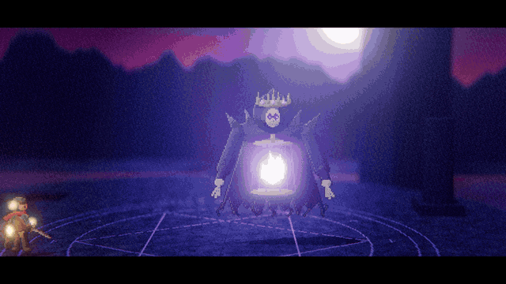
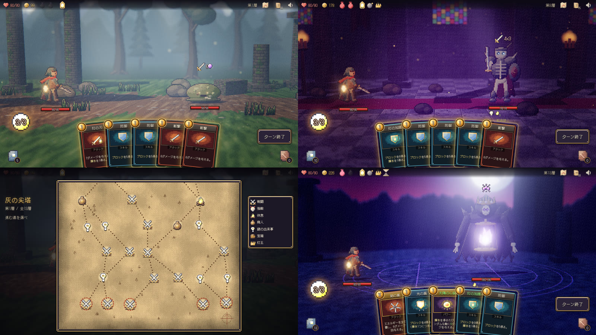

# 灯守の巡礼 ― Lanternfall

消えゆく「大灯」を取り戻すため、灯守がランタンを携えて灰の尖塔を登る――
ブラウザで遊べる **HD-2D風デッキ構築ローグライト** です。
ピクセルアートのキャラクターを WebGL の立体ステージに立たせ、被写界深度・ブルーム・リアルタイム光源と影・霧・パーティクルで「ジオラマの中で戦っている」質感を狙いました。
1回の冒険は全13層、想定プレイ時間は20〜30分です（人間による実測は未確認。下記「既知の問題」参照）。





> 上のGIFは実際に動いているゲームをヘッドレスブラウザで録画したものです（約14秒、ボス戦）。
> カード操作はゲーム内の自動操縦（`?auto`）が行い、録画しやすいようにデモ用の開始状態（`?demo=boss`：中盤相当のデッキ、ボスHP 62%から開始）を使っています。映像そのものの加工・差し替えはしていません。
> 長めの動画: [docs/demo-boss.mp4](docs/demo-boss.mp4)（ボス戦・約16秒） / [docs/demo-run.mp4](docs/demo-run.mp4)（タイトルから通常プレイ・約44秒）

---

## ゲームの特徴

- **ターン制カードバトル**：毎ターン エネルギー3 と手札5枚。敵の頭上に「次の行動」（攻撃値・防御・強化・弱体・召喚・溜め）が常に予告されます。
- **5つのデッキ方針**（カード41種＝報酬プール35種＋初期3種＋状態異常/呪い3種）
  - 灼熱：毎ターン燃やし、「業火」で倍化、「爆燃」で一気に爆発させる
  - 輝き：灯の力を最大10まで蓄え、「閃光斬」「天光」で解き放つ。「太陽の心臓」「灯台」とシナジー
  - ブロック：「盾撃」「鏡盾」「堅守」「茨の鎧」で守りを攻めに変える
  - 筋力・連撃：「闘志」＋「双牙」「三段突き」「剣の嵐（X）」
  - 焼却：「灰の儀」「灰の契約」「灰燼撃」で山札を圧縮し、焼却枚数を力に変える
- **レリック18種・霊薬8種**、戦闘開始・ターン開始・焼却・撃破などのフックでシナジーを作れます。
- **分岐マップ**（13層・6本の道筋、交差なし）：戦闘／強敵／休息／商人／謎の出来事（7種）／宝箱／ボス。
- **敵13種**（通常7・強敵3＋手下2・ボス1）。骸骨騎士の不死、燭台の燭火召喚、石像の石肌、ボス「虚ろの灯王」の2段階フェーズ（50%で覚醒し、溜め→大技の周期が変化）など、敵ごとに対処法が異なります。
- **HD-2D演出**
  - 3つのステージ（霧の森・崩れた礼拝堂・尖塔の頂）。遠景シルエット／中景／前景の柱・草でレイヤーを作り、被写界深度で奥行きを強調
  - キャラクターは待機・溜め・斬撃・被弾・詠唱・防御などのフレームアニメーション
  - 攻撃時のカメラ寄り、ズーム、画面揺れ、ヒットストップ、スローモーション、フラッシュ
  - レアカード・高コストカードではレターボックス付きのカットイン、ボスには登場演出と覚醒演出（月が赤く染まり、光源・色調が変化）
  - 演出中はカードUIを自動で引っ込め、通常時は情報を見やすく表示
- **サウンド**：WebAudioによるプロシージャル生成のBGM 8曲（タイトル・マップ・通常戦闘・強敵・ボス2形態・休息・商人）、効果音約40種、環境音（森・礼拝堂・山頂・焚き火）。

アート（ドット絵・テクスチャ・アイコン・カード絵）と音はすべてコードから生成しており、外部の画像・音声素材は使っていません。フォントのみ [DotGothic16](https://fonts.google.com/specimen/DotGothic16)（SIL Open Font License）を使用中の文字だけにサブセット化して同梱しています。

## 操作方法

| 操作 | マウス / タッチ | キーボード |
| --- | --- | --- |
| カードを使う | カードを敵（または上方）へドラッグ＆ドロップ／クリックで選択→敵をクリック | `1`〜`9` で選択 |
| 取り消し | 右クリック | `Esc` |
| ターン終了 | 「ターン終了」ボタン | `E` |
| 山札・捨て札・焼却済みを見る | 左下・右下の束をクリック | |
| 霊薬を使う | 上部バーの霊薬をクリック（対象が必要なものは敵をクリック） | |
| キーワード説明 | カード・状態アイコン・レリックにカーソルを合わせる | |
| 地図を見る／デッキを見る／ミュート | 右上のアイコン | |

## 起動・プレイ方法

Node.js 20 以上が必要です。

```bash
git clone https://github.com/onego15/slay-claude.git
cd slay-claude
npm install
npm run dev          # http://127.0.0.1:5173 を開く
```

本番ビルド：

```bash
npm run build        # dist/ に出力（静的ファイルなので任意のWebサーバーで配信可）
npm run preview      # http://127.0.0.1:4173
npm run build:single # dist-single/index.html 1ファイルにまとめたビルド
```

`main` への push で GitHub Pages へデプロイするワークフロー（`.github/workflows/pages.yml`）を同梱しています。このワークフロー上でシミュレーター（200回×7方針）と本番ビルドは成功していますが、リポジトリの Pages 設定が未有効のため公開ステップで止まっています。Settings → Pages → Source を「GitHub Actions」にすると公開されます（公開後の動作は**未確認**）。

推奨環境：WebGL2 対応のデスクトップブラウザ（Chrome / Edge / Firefox 最新版）。音は最初のクリック後に鳴り始めます。

開発・検証用のURLパラメータ：

| パラメータ | 内容 |
| --- | --- |
| `?seed=N` | 乱数シードを固定 |
| `?auto` | 自動操縦（`&strat=burn` 等で方針指定、`&god` で無敵） |
| `?demo=boss` / `elite` / `normal` | 中盤相当のデッキで戦闘から開始（録画・見た目確認用） |
| `?capture` | 仮想時間モード（`window.__advance(ms)` で1コマずつ進める。録画用） |
| `?stage=forest` / `chapel` / `summit` | ステージ単体の表示 |

## 使用したAIサービスとモデル

- AIサービス：Anthropic **Claude**（Claude Code をクラウド環境で実行、Claude のプロジェクト／スレッド機能経由）
- モデル：**`claude-opus-5-5`**（Claude Opus 5.5）
  - 根拠：作業中にセッション情報を取得し、設定モデル `claude-opus-5-5[1m]`、直近ターンの実行モデル `claude-opus-5-5` を確認。
  - 環境には別モデルへの自動フォールバック設定があり、全ターンが同じモデルで処理されたかは個別に確認できていないため、その点は**未確認**です。

## 使用技術

- 言語：JavaScript（ES Modules）、HTML、CSS
- ゲームエンジン：なし（自作）。描画は [three.js](https://threejs.org/) r180（WebGL2）
  - ビルボード化したピクセルスプライト＋立体ジオメトリのステージ、シャドウマップ、FogExp2、点光源／平行光源／半球光
  - ポストエフェクト：自作の深度ベース被写界深度パス（ティルトシフト併用）→ UnrealBloom → 自作グレーディングパス（ビネット・彩度・リフト/ゲイン・色収差・放射ブラー・フィルムグレイン）→ ACESトーンマッピング
  - GPUパーティクル（Points＋カスタムシェーダー）、スプライトのフラッシュ／ディゾルブ／ティント用シェーダー改造
- ドット絵：自作の `Painter`（陰影付き楕円・多角形・ディザ・アウトライン・リムライト・発光マップ）でキャラ・背景・アイコン・カード絵を手続き生成。全素材を 32px/ワールド単位 の同一ピクセル密度に統一
- UI：DOM＋CSS（1280×720 の設計座標で拡縮）、9スライスのドット枠、Web Animations API
- サウンド：Web Audio API（オシレーター＋ノイズ＋畳み込みリバーブによる手続き生成）
- ビルド：Vite 8、vite-plugin-singlefile
- テスト：Node.js によるヘッドレス戦闘シミュレーター、Playwright（Chromium＋SwiftShader）による実ブラウザ通しプレイ
- 録画：Playwright で仮想時間を1コマずつ進めてキャプチャ → ffmpeg で GIF / MP4 化

ソース構成：

```
src/core/   ルール（カード・敵・レリック・霊薬・戦闘エンジン・マップ・イベント・乱数）※描画非依存
src/ai/     自動プレイ用ボット（シミュレーターとブラウザ自動操縦で共用）
src/gfx/    HD-2D描画（ステージ・スプライト生成・ポストエフェクト・パーティクル・演出・時計）
src/ui/     DOM UI（手札・カード・ツールチップ・マップの羊皮紙）
src/audio/  BGM・効果音・環境音
src/battle.js 戦闘の演出ディレクター、src/game.js 画面遷移と冒険の進行
sim/        バランスシミュレーター
tools/      スクリーンショット・ブラウザE2E・録画・フォントサブセット用スクリプト
```

## 制作日時と経過時間

| 項目 | 日時（UTC） | 根拠 |
| --- | --- | --- |
| 制作開始 | 2026-10-21 06:43:19 | 依頼メッセージの投稿時刻（プロジェクトのチャット記録） |
| 制作終了 | 2026-10-21 10:24:24 | README の内容を確定した時刻（この直後に成果物一式をコミット・push。以降の変更はこの表の文言修正のみ） |
| 経過時間 | 約3時間41分 | 上記2つの差 |

途中、2026-10-21 08:08頃〜10:15頃（UTC）は実行環境側のAPIエラーで作業が中断しており、その後自動再開しています。この中断時間も経過時間に含まれています。正味の作業時間は**未確認**です。

## 実施したテストと結果

### 1. 戦闘・冒険シミュレーター（`npm run sim -- 200`）

描画を使わずにルールエンジンだけで冒険を最初から最後まで自動プレイし、統計と不変条件を確認します。7種類のボット方針 × 200回 = 1400回。

| ボット方針 | 勝率 | 平均到達階層 |
| --- | --- | --- |
| バランス | 16.0% | 10.0 |
| 灼熱 | 24.5% | 10.5 |
| 輝き | 11.0% | 10.0 |
| ブロック | 11.0% | 10.4 |
| 筋力・連撃 | 17.5% | 10.3 |
| 焼却 | 11.5% | 9.8 |
| ランダム（報酬・イベントを無作為に選択） | 13.0% | 9.9 |

強敵・ボス戦（敗北数/挑戦数、平均被ダメージ、平均ターン数、戦闘開始時の平均HP）：

```
lantern_king                         boss     394/603   dmg  56.1  turns 9.6  hpIn 52
candelabra                           elite    123/272   dmg  39.2  turns 5.9  hpIn 47
bone_knight                          elite     71/203   dmg  43.6  turns 5.7  hpIn 50
gargoyle                             elite     76/278   dmg  35.1  turns 4.7  hpIn 48
```

```
== Checks
PASS  no engine exceptions  
PASS  no stalemated fights (60-turn cap)  0 runs
PASS  ending reachable (some runs win)  209 wins
PASS  every playable card was played by the bots  
```

確認している不変条件（1つでも満たさなければ終了コード1）：エンジン例外が出ない／60ターン以上続く膠着戦闘がない／エンディングに到達できる／報酬プールの全カードが実際に使用される。

読み方の注意：ボットは「その場で最も点数の高いカードを出す」単純な貪欲法で、先読みや手札・デッキの長期計画はしません。勝率は人間のプレイ水準を示すものではなく、「方針ごとの相対的な強さ」と「突出した壊れ・死にカードがないか」を見るために使っています。人間による難易度の実測は**未確認**です。

### 2. 実ブラウザでの通しプレイ（`npm run e2e -- <seed> <方針> <無敵>`）

ビルドした本番ファイルを Chromium（Playwright・SwiftShader）で開き、ゲーム内の自動操縦が実際のUI（タイトル→導入→地図→各マス→報酬→…→エンディング）を操作します。ページエラー・コンソールエラー・進行停止（一定時間操作が進まない）を検出すると失敗になります。

| シード | ボット方針 | 無敵 | 結果 | 自動操作数 | エラー |
| --- | --- | --- | --- | --- | --- |
| 3 | バランス | あり | 第13層ボス撃破 → エンディング | 234 | 0 |
| 11 | 灼熱 | あり | 第13層ボス撃破 → エンディング | 336 | 0 |
| 21 | 輝き | あり | 第13層ボス撃破 → エンディング | 196 | 0 |
| 33 | 筋力・連撃 | あり | 第13層ボス撃破 → エンディング | 211 | 0 |
| 5 | バランス | なし | 第10層で敗北 → 敗北画面 | 135 | 0 |
| 8 | ブロック | なし | 第10層で敗北 → 敗北画面 | 129 | 0 |

6回すべてで、ページエラー・コンソールエラー・進行停止は発生しませんでした（最終ビルドで実施）。「無敵」は最後まで到達させて全画面を通すためのテスト用設定です。開発途中には、この通しプレイで「敵ターン後に操作不能」「イベント中の戦闘後に進行不能」の2件の進行不能バグを発見して修正しています。

### 3. 画面確認（スクリーンショット）

`tools/shot.cjs` と E2E のギャラリーモードで、タイトル・導入・地図・通常戦闘（森／礼拝堂）・強敵戦・ボス戦（覚醒前後）・報酬・カード選択・休息・強化選択・商人・イベント・宝箱・エンディングの各画面を撮影し、見た目の問題を洗い出して修正→再撮影を繰り返しました（主な修正内容は次節）。

### 未実施・未確認のテスト

- 人間による実プレイ（操作感・難易度・1回20〜30分という所要時間）は**未確認**
- 実GPU環境でのフレームレートは**未確認**（検証環境はGPUなしのソフトウェア描画で、1コマ約1秒かかるため仮想時間で検証）
- 音（BGM・効果音・環境音）は生成処理がエラーなく動くことのみ確認。実際の聞こえ方は**未確認**（検証環境に音声出力がないため）
- Safari・モバイル端末での動作は**未確認**
- GitHub Pages での公開は**未確認**（Pages 設定が未有効のため。CI 上のシミュレーターとビルドは成功）

## グラフィック・UI・バランスの改善内容

実際にブラウザで起動して撮ったスクリーンショットをもとに、主に次の修正を行いました。

**グラフィック**
- パーティクルが巨大な四角形で描画されていた不具合を修正（ポイントサイズ係数の誤り）
- プレイヤーのランタン光が強すぎて白飛びしていたのを調整
- ディザリングが粗すぎてノイズに見えたため、ディザの帯域を狭めて階調を整理
- ボスのドット絵を描き直し（王冠・髑髏の仮面・胸の檻に囚われた灯）。覚醒時は配色と舞台照明が赤く変化
- 尖塔の頂：のっぺりした青い霧だった空を、夕闇のグラデーション＋地平線の残照＋山並みのシルエット＋月に作り直し。遠景のボケを弱めて星と月が見えるように調整。黒い塊に見えた浮遊岩を撤去
- 礼拝堂：暗すぎて何も見えなかったため、露出・環境光・壁の色を見直し、ステンドグラスの位置と大きさを調整
- 暗いステージでもキャラクターが沈まないよう、ステージごとにスプライトの補助光（自己照明）を追加
- 被弾フラッシュが強すぎてブルームで敵が真っ白に飛んでいたのを抑制

**UI/UX**
- 地図：暗い無地の枠を、ドット絵の羊皮紙（シミ・繊維・周辺の焼け・森と山のインクスケッチ・方位図）とインクの点線に変更
- 戦闘画面の構図を調整し、敵のHPバー・状態表示が手札に隠れないようにカメラの注視点と手札の大きさ・位置を変更
- 狙いを定めるカードを画面中央に大きく表示していたため戦場が隠れていた → 手札の位置で持ち上げるだけに変更。使用中のカードもプレイヤーと敵の間の小さめの位置に表示
- カットイン・ボス覚醒などの演出中は手札・エネルギー・ボタンを自動で隠す
- 「ターン終了」ボタンを右下に移動し、敵のHUDと重ならないようにした
- カード説明文がキーワード強調部分で不自然に改行されていた不具合を修正、文字サイズとイラスト枠を調整して説明文がはみ出さないようにした
- コスト表示を読みやすい金色の宝珠に変更、エネルギー表示の文字に縁取り
- 休息画面：選択肢が焚き火を覆っていたので配置を変更、HP満タン時は「HPは満タン」と表示して選べないようにした
- 宝箱・イベント・タイトル：パネルやロゴが主役（宝箱・小道具・主人公）に重ならないよう配置とカメラを調整
- 飛行する敵の行動予告アイコンが高すぎる位置に出る不具合（高さの二重加算）を修正

**不具合修正（通しプレイで発見）**
- 敵ターン終了後に操作を受け付けなくなる不具合
- イベントから戦闘に入ると、戦闘後にイベント画面が消えて進行不能になる不具合
- 休息後に休息画面のタイトルが地図の裏に残る不具合
- ターン開始時のエネルギー表示が一瞬 0 になる不具合

**バランス（シミュレーター結果に基づく調整）**
- 最初の計測ではボスに到達した冒険の約82%がボスで敗北していたため、ボス（HP 200→180、大技 30/36→28/32、炎上量の減少）、手下の灯魂、強敵「呪いの燭台」と「骸骨騎士」を弱体化
- 勝率の低かった「輝き」と「焼却」方針を強化（光弾・閃光斬・天光・太陽の心臓・灯台の強化版、灰燼撃・灰の儀・灰の契約）
- 突出していた「灼熱」方針の要「燃ゆる魂」を弱体化（3→2）

## 既知の問題と未完成部分

- 人間による通しプレイ・難易度評価を行っていません。ボットの勝率は低め（11〜25%）ですが、人間にとっての難易度は**未確認**です。
- 方針間の強さには差が残っています（シミュレーター上は灼熱がもっとも強く、輝き・ブロック・焼却が弱め）。レリックでは「太陽石」（エネルギー+1）と「戦鼓」を持つ冒険の勝率が高く、強めです。
- 実GPUでの描画負荷は未計測です。被写界深度・ブルーム・影を使うため、内蔵GPUのノートPCなどでは重い可能性があります（画質設定はありません）。
- ゲームの中断・再開（セーブ）機能はありません。ページを再読み込みすると冒険は最初からになります。
- 敵は13種・ステージは3種・イベントは7種と少なめで、繰り返し遊ぶと見覚えのある展開が増えます。
- 効果音・BGMはすべて手続き生成で、実際の音質は確認できていません。
- 画面は 1280×720 を基準に拡縮します。縦長のスマートフォン画面では文字が小さくなります。
- ブラウザのタブを非表示にしている間はアニメーションが停止します。
- デモGIFは録画の都合で自動操縦とデモ用開始状態を使っています（上記の注記参照）。

## 制作に使用した依頼プロンプト（全文・原文のまま）

```text
Slay the Spireに着想を得た、オリジナルのデッキ構築ローグライトゲームを制作してください。
ブラウザで快適にプレイでき、1回の冒険を20〜30分程度で楽しめる、商業インディーゲームのような完成度を目指してください。
最も重視するのは、戦略性の高いカードバトル、デッキ構築の面白さ、HD-2D風の美しい戦闘画面、統一感のあるアートスタイル、洗練されたUI/UXです。
1. ゲーム内容

* ターン制のカードバトル
* 攻撃、防御、補助、特殊効果など、役割の異なる多彩なカード
* 戦闘後のカード報酬によるデッキ強化
* 分岐するマップとランダムイベント
* ショップ、休息、強敵、ボス戦
* レリックなどによる継続的な特殊効果
* カード同士のシナジーを活用したデッキ構築
* 冒険をクリアするか敗北すると1回の挑戦が終了する
* 繰り返し遊んでも異なる展開を楽しめるランダム性

2. HD-2D風の戦闘画面（最重要）
戦闘画面は、オクトパストラベラーのようなHD-2D表現に着想を得た、奥行きと空気感のあるビジュアルにしてください。
単に美しい背景画像の上にカードUIを配置するのではなく、キャラクターや敵が立体的なステージの中に存在しているような表現を目指してください。

* ピクセルアートと立体的な空間表現を組み合わせる
* 遠景・中景・前景を活用し、明確な奥行きを感じられる構図にする
* 被写界深度、ブルーム、ライティング、影、霧、パーティクルなどを効果的に使用する
* キャラクターや敵のドット絵と背景のピクセル密度、色彩、デザインを統一する
* 敵やプレイヤーキャラクターに自然な待機・攻撃・被弾アニメーションを用意する
* 攻撃時のカメラ移動、ズーム、画面揺れ、ヒットストップなどで気持ちのよい演出を行う
* 強力なカードやボス戦では、通常戦闘と異なる印象的な演出を取り入れる
* 演出の派手さだけでなく、戦闘のテンポと情報の見やすさを両立する

HD-2Dの表現方法や描画技術は自由です。2D・3Dの組み合わせ、WebGL、シェーダー、多層レイヤーなど、最も高品質な作品を実現できる方法を選んでください。
3. ゲームデザイン・戦略性
カードの種類が多いだけではなく、カードを組み合わせて強力な戦術を生み出す楽しさを重視してください。

* 複数の異なるデッキ構築方針が成立する
* カード同士やレリックとのシナジーを用意する
* 敵ごとに異なる行動パターンと攻略方法を設ける
* 敵の次の行動を予告し、プレイヤーが戦略を立てられるようにする
* 攻撃、防御、リソース管理の判断が重要になるよう設計する
* カード報酬やルート選択に意味のある選択肢を用意する
* 強力すぎる組み合わせや役に立たないカードを可能な限り調整する
* ランダム性だけで勝敗が決まらず、プレイヤーの判断が結果に反映されるようにする

大量のカードやステージを実装することより、限られたカードでも多様な戦略が成立する完成度を優先してください。
4. アートディレクション・UI/UX
ゲーム全体を一つの商業作品としてデザインしてください。

* 世界観、キャラクター、背景、カード、アイコン、UI、音響に統一感を持たせる
* カードは効果、コスト、対象が直感的に分かるデザインにする
* 敵のHP、次の行動、状態異常などを分かりやすく表示する
* ドラッグ＆ドロップやクリックでカードを快適に操作できる
* カードのホバー、選択、使用、破棄などに自然で気持ちのよいアニメーションを用意する
* ショップ、報酬選択、マップ、デッキ確認などの画面も丁寧にデザインする
* 単なる一般的なWebアプリのようなUIではなく、世界観に合ったゲームらしいUIにする
* 必要な情報は見やすく保ち、過剰な装飾や情報の詰め込みを避ける
* BGM、効果音、環境音を使ってプレイ体験を高める

5. 技術・制作方針

* ブラウザで快適に遊べることを必須とする
* ゲームエンジン、フレームワーク、言語、アセット制作方法は自由
* 利用条件を遵守した公開アセットを使用してもよい
* 原作のキャラクター、カード画像、名称、文章、音楽などはコピーせず、オリジナル作品にする
* コンテンツ量よりも、最終的な完成度を優先する
* 私への途中確認や質問は不要

6. 品質改善・自律制作（最重要）
ゲームが動作するようになった段階では、まだ完成ではありません。
基本機能の実装後、グラフィック、アニメーション、演出、UI/UX、ゲームバランスを改善する工程を必ず設けてください。
特に以下を徹底してください。

* 機能が実装されたことだけを理由に完成と判断しない
* 実際にブラウザでゲームを起動し、スクリーンショットを確認して、見栄えの悪い部分を改善する
* 仮素材やプリミティブ図形を使った場合は、意図的なアートスタイルとして成立していない限り、完成度の高い素材へ置き換える
* 背景、キャラクター、カード、UI、アニメーション、音響まで一貫したアートディレクションを行う
* 初回実装で満足せず、問題の発見・修正・再確認のサイクルを繰り返す
* 制作時間の短縮よりも、最終的なゲーム品質を優先する
* コンテンツを増やすより、少ない要素を高品質に仕上げる
* 利用可能な作業時間・ツール・実行予算の範囲で、可能な限り完成度を高める

目標は動作する技術デモではなく、人が何度も遊びたくなる、視覚的にも完成されたゲームです。
7. テスト・ゲームバランス検証
可能な限り自動プレイやシミュレーションを行い、以下を確認してください。

* 戦闘開始から勝利・敗北まで正常に進行する
* カード効果、状態異常、敵AIが正しく動作する
* カードの使用・ドロー・破棄・ターン終了が正常に処理される
* マップ選択、報酬、ショップ、休息、ボス戦が正常に進行する
* 複数回のプレイで、異なるデッキ構築方針が成立する
* 特定のカードやレリックによる極端なバランス崩壊がない
* 最初からエンディングまで到達できる
* 意図しない進行不能やUIの操作不能が発生しない

また、戦闘画面を実際に表示して、HD-2Dらしい奥行き、ライティング、キャラクターの視認性、演出の完成度を確認してください。
問題が見つかった場合は修正し、再テストしてください。
8. GitHub README・制作記録
README.mdには以下を含めてください。

1. ゲームタイトルと概要
2. 実際のゲームプレイを録画した10〜15秒程度のGIFアニメーション
   * `docs/demo.gif` に配置してREADME冒頭付近に埋め込む
   * HD-2D戦闘画面、カード使用時の演出、ボス戦などを優先して収録
   * 可能なら長めのMP4プレイ動画も保存
3. ゲームの特徴と操作方法
4. ブラウザでの起動・プレイ方法
5. 使用したAIサービス名と正確なモデル名
6. 使用技術・ゲームエンジン
7. 制作開始・終了日時と経過時間（確認できる範囲）
8. 実施したテストと結果
9. グラフィック・UI・バランスについて改善した内容
10. 制作に使用した、この依頼プロンプトの全文（省略・要約・改変禁止）
11. 既知の問題と未完成部分

GIFは実際に動作するゲームを録画したものを使用し、架空のプレイ映像で代用しないでください。
モデル名、制作時間、テスト結果など、確認できない情報は推測せず「未確認」と記載してください。
9. 最終的な完成条件

* ブラウザで正常にプレイできる
* 冒険の開始からボス撃破・エンディングまで遊べる
* カード同士のシナジーがあり、戦略的なデッキ構築を楽しめる
* 戦闘画面にHD-2Dらしい奥行きと印象的な演出がある
* グラフィック、カード、UI、音響に統一感がある
* 基本機能の完成後に、実際のプレイ・画面確認に基づく改善が行われている
* READMEとプレイGIFが用意されている

制作途中の確認は不要です。企画、設計、実装、アセット制作、テスト、バランス調整、グラフィック改善、README作成まで、利用可能なツールの範囲で自律的に進めてください。
実行環境の制約などで実施できなかった工程は、完了したと装わず正直に報告してください。
```

## フォントのライセンス

DotGothic16 は SIL Open Font License 1.1（Copyright 2020 The DotGothic16 Project Authors）。ライセンス全文は [src/assets/OFL-DotGothic16.txt](src/assets/OFL-DotGothic16.txt) にあります。
